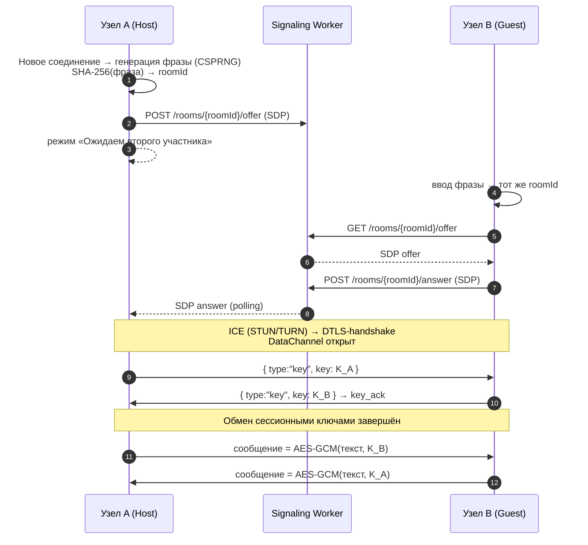

<div align="center">

<svg width="120" height="120" viewBox="0 0 24 24" fill="none" xmlns="http://www.w3.org/2000/svg">
  <path d="M12 2.5l8.2 4.75v9.5L12 21.5l-8.2-4.75v-9.5L12 2.5z" stroke="#38bdf8" stroke-width="1.5" stroke-linejoin="round">
    <animate attributeName="stroke-dasharray" values="0 100;100 0;0 100" dur="4s" repeatCount="indefinite"/>
  </path>
  <circle cx="12" cy="12" r="3.6" stroke="#38bdf8" stroke-width="1.5">
    <animate attributeName="r" values="3.2;3.8;3.2" dur="2s" repeatCount="indefinite"/>
    <animate attributeName="opacity" values="0.6;1;0.6" dur="2s" repeatCount="indefinite"/>
  </circle>
  <path d="M9.4 15.2l5.2-6.4" stroke="#38bdf8" stroke-width="1.5" stroke-linecap="round">
    <animate attributeName="stroke-dasharray" values="0 10;10 0" dur="1.5s" repeatCount="indefinite"/>
  </path>
</svg>

# /0byte/

**Децентрализованный P2P-мессенджер с end-to-end шифрованием.**
Без аккаунтов. Без серверов хранения. Без следов.

Сообщения существуют только на устройствах собеседников,
соединение устанавливается по **секретной фразе**,
а ключи шифрования никогда не покидают ваши устройства.

<br>


<br>

[Как это работает](#-как-это-работает) · [Безопасность](#-модель-безопасности) · [Как создать чат](#-как-создать-чат) · [Архитектура](#-архитектура)

</div>

---

## <svg width="20" height="20" viewBox="0 0 24 24" fill="none" xmlns="http://www.w3.org/2000/svg"><path d="M13 2L3 14h9l-1 8 10-12h-9l1-8z" stroke="#38bdf8" stroke-width="2" stroke-linecap="round" stroke-linejoin="round"><animate attributeName="stroke-dasharray" values="0 40;40 0" dur="2s" repeatCount="indefinite"/></path></svg> Возможности

<table>
<tr>
<td width="50%" valign="top">

**<svg width="16" height="16" viewBox="0 0 24 24" fill="none"><rect x="3" y="11" width="18" height="11" rx="2" stroke="#38bdf8" stroke-width="2"><animate attributeName="stroke-dasharray" values="0 60;60 0" dur="3s" repeatCount="indefinite"/></rect><path d="M7 11V7a5 5 0 0 1 10 0v4" stroke="#38bdf8" stroke-width="2" stroke-linecap="round"><animate attributeName="stroke-dasharray" values="0 30;30 0" dur="2s" repeatCount="indefinite"/></path></svg> E2E-шифрование**
AES-256-GCM со случайным IV 12 B для каждого сообщения и файла.

**<svg width="16" height="16" viewBox="0 0 24 24" fill="none"><path d="M21 2l-2 2m-7.6 7.6a5.5 5.5 0 1 1-7.8 7.8 5.5 5.5 0 0 1 7.8-7.8zm0 0L15.5 7.5m0 0l3 3L22 7l-3-3m-3.5 3.5L19 4" stroke="#38bdf8" stroke-width="2" stroke-linecap="round" stroke-linejoin="round"><animate attributeName="stroke-dasharray" values="0 60;60 0" dur="3s" repeatCount="indefinite"/></path></svg> Секретная фраза вместо SDP**
Фраза вида `тихий-волк-042`, произнесённая голосом или переданная в доверенном канале.

**<svg width="16" height="16" viewBox="0 0 24 24" fill="none"><path d="M23 4v6h-6M1 20v-6h6" stroke="#38bdf8" stroke-width="2" stroke-linecap="round" stroke-linejoin="round"><animate attributeName="stroke-dasharray" values="0 30;30 0" dur="2s" repeatCount="indefinite"/></path><path d="M3.5 9a9 9 0 0 1 14.9-3.4L23 10M1 14l4.6 4.4A9 9 0 0 0 20.5 15" stroke="#38bdf8" stroke-width="2" stroke-linecap="round" stroke-linejoin="round"><animate attributeName="stroke-dasharray" values="0 60;60 0" dur="3s" repeatCount="indefinite"/></path></svg> Автораспределение ролей**
Host и Guest договариваются сами, без ручной настройки.

**<svg width="16" height="16" viewBox="0 0 24 24" fill="none"><path d="M12 22s8-4 8-10V5l-8-3-8 3v7c0 6 8 10 8 10z" stroke="#38bdf8" stroke-width="2" stroke-linecap="round" stroke-linejoin="round"><animate attributeName="stroke-dasharray" values="0 60;60 0" dur="4s" repeatCount="indefinite"/></path></svg> Шифрование at-rest**
Контакты и история в `localStorage` защищены мастер-паролем (PBKDF2 → AES-GCM).

</td>
<td width="50%" valign="top">

**<svg width="16" height="16" viewBox="0 0 24 24" fill="none"><rect x="9" y="9" width="13" height="13" rx="2" stroke="#38bdf8" stroke-width="2"><animate attributeName="stroke-dasharray" values="0 50;50 0" dur="3s" repeatCount="indefinite"/></rect><path d="M5 15H4a2 2 0 0 1-2-2V4a2 2 0 0 1 2-2h9a2 2 0 0 1 2 2v1" stroke="#38bdf8" stroke-width="2" stroke-linecap="round" stroke-linejoin="round"><animate attributeName="stroke-dasharray" values="0 30;30 0" dur="2s" repeatCount="indefinite"/></path></svg> Ротация ключей**
Каждая сессия создаёт свежие ключи, старые сохраняются для расшифровки истории.

**<svg width="16" height="16" viewBox="0 0 24 24" fill="none"><rect x="3" y="3" width="18" height="18" rx="2" stroke="#38bdf8" stroke-width="2"><animate attributeName="stroke-dasharray" values="0 70;70 0" dur="3s" repeatCount="indefinite"/></rect><circle cx="8.5" cy="8.5" r="1.5" stroke="#38bdf8" stroke-width="2"><animate attributeName="r" values="1.2;1.8;1.2" dur="2s" repeatCount="indefinite"/></circle><path d="M21 15l-5-5L5 21" stroke="#38bdf8" stroke-width="2" stroke-linecap="round" stroke-linejoin="round"><animate attributeName="stroke-dasharray" values="0 30;30 0" dur="2s" repeatCount="indefinite"/></path></svg> Зашифрованные изображения**
Со сжатием на стороне клиента (до 800 px, JPEG 0.85).

**<svg width="16" height="16" viewBox="0 0 24 24" fill="none"><circle cx="12" cy="12" r="4" stroke="#38bdf8" stroke-width="2"><animate attributeName="r" values="3.6;4.2;3.6" dur="2s" repeatCount="indefinite"/><animate attributeName="opacity" values="0.5;1;0.5" dur="2s" repeatCount="indefinite"/></circle><path d="M12 2v2M12 20v2M4.9 4.9l1.4 1.4M17.7 17.7l1.4 1.4M2 12h2M20 12h2M4.9 19.1l1.4-1.4M17.7 6.3l1.4-1.4" stroke="#38bdf8" stroke-width="2" stroke-linecap="round"><animate attributeName="opacity" values="0.6;1;0.6" dur="2s" repeatCount="indefinite"/></path></svg> Тёмная и светлая темы**
Адаптивный UI в стиле glassmorphism и gunmetal.

**<svg width="16" height="16" viewBox="0 0 24 24" fill="none"><path d="M13 2L3 14h9l-1 8 10-12h-9l1-8z" stroke="#38bdf8" stroke-width="2" stroke-linecap="round" stroke-linejoin="round"><animate attributeName="stroke-dasharray" values="0 40;40 0" dur="2s" repeatCount="indefinite"/></path></svg> Ноль зависимостей**
Чистый vanilla JS + Web Crypto API + WebRTC.

</td>
</tr>
</table>

---

## <svg width="20" height="20" viewBox="0 0 24 24" fill="none" xmlns="http://www.w3.org/2000/svg"><path d="M21 2l-2 2m-7.6 7.6a5.5 5.5 0 1 1-7.8 7.8 5.5 5.5 0 0 1 7.8-7.8zm0 0L15.5 7.5m0 0l3 3L22 7l-3-3m-3.5 3.5L19 4" stroke="#38bdf8" stroke-width="2" stroke-linecap="round" stroke-linejoin="round"><animate attributeName="stroke-dasharray" values="0 60;60 0" dur="3s" repeatCount="indefinite"/></path></svg> Как это работает

Сигнальный сервер (Cloudflare Worker) передаёт **только SDP** и не видит ни сообщений, ни ключей. После handshake трафик идёт напрямую между браузерами.



1. **Фраза → комната.** Нормализованная фраза хэшируется SHA-256, первые 16 hex-символов становятся `roomId`.
2. **Signaling.** Host публикует offer, Guest забирает его и публикует answer. Комната закрывается сразу после установки канала.
3. **P2P-канал.** WebRTC DataChannel (`ordered`) через STUN/TURN — работает даже за строгими NAT.
4. **Обмен ключами.** Каждый узел генерирует 256-битный сессионный ключ (CSPRNG) и отправляет его по каналу; ретрансляция продолжается до `key_ack`.
5. **Шифрование.** Исходящее шифруется ключом собеседника, входящее расшифровывается своим; история хранится локально.

---

## <svg width="20" height="20" viewBox="0 0 24 24" fill="none" xmlns="http://www.w3.org/2000/svg"><path d="M12 22s8-4 8-10V5l-8-3-8 3v7c0 6 8 10 8 10z" stroke="#38bdf8" stroke-width="2" stroke-linecap="round" stroke-linejoin="round"><animate attributeName="stroke-dasharray" values="0 60;60 0" dur="4s" repeatCount="indefinite"/><animate attributeName="opacity" values="0.5;1;0.5" dur="3s" repeatCount="indefinite"/></path></svg> Модель безопасности

| Слой | Примитив | Где применяется |
|---|---|---|
| Транспорт | WebRTC DataChannel (DTLS) | прямой канал узел ↔ узел |
| Сообщения и файлы | **AES-256-GCM**, случайный IV 12 B | `crypto.js → encrypt / encryptData` |
| Сессионные ключи | 256-bit CSPRNG, обмен `key` / `key_ack` | только в памяти + локальные key-листы |
| Мастер-пароль (at-rest) | **PBKDF2-SHA-256 · 100 000 итераций · salt 16 B** → AES-256-GCM | контакты и история в `localStorage` |
| Идентификатор комнаты | `SHA-256(фраза)[0:16]` | signaling |
| Секретная фраза | CSPRNG, формат «прилагательное-существительное-NNN» | передаётся в доверенном канале |

> **Честный дисклеймер.**
> Фраза — одноразовый ключ доступа к комнате signaling; передавайте её голосом или лично. Проект исследовательский, независимого аудита не проходил. Утеря мастер-пароля означает безвозвратную потерю данных — это фича, а не баг.

---

## <svg width="20" height="20" viewBox="0 0 24 24" fill="none" xmlns="http://www.w3.org/2000/svg"><path d="M22 2L11 13M22 2l-7 20-4-9-9-4 20-7z" stroke="#38bdf8" stroke-width="2" stroke-linecap="round" stroke-linejoin="round"><animate attributeName="stroke-dasharray" values="0 40;40 0" dur="2s" repeatCount="indefinite"/><animateTransform attributeName="transform" type="translate" values="0 0;1 -1;0 0" dur="3s" repeatCount="indefinite"/></path></svg> Как создать чат

### Узел A — инициатор

1. Откройте приложение, примите протокол, при желании задайте мастер-пароль.
2. Нажмите **«Новое соединение»** → иконку кубика — появится фраза, например `ТИХИЙ-ВОЛК-042`.
3. Продиктуйте фразу собеседнику (лично, по телефону — любому доверенному каналу).
4. Дождитесь статуса «Ожидаем второго участника» → «Защищённое соединение установлено».

### Узел B — собеседник

1. Откройте приложение на своём устройстве.
2. **«Новое соединение»** → вставьте или введите фразу → **«Установить соединение»**.
3. Роли Host/Guest распределятся автоматически, ключи обменяются сами — индикатор загорится зелёным: `защищённый канал`.

### Повторное подключение

Фраза сохраняется у контакта — достаточно кнопки **«Переподключиться»** в баннере чата.

---

## <svg width="20" height="20" viewBox="0 0 24 24" fill="none" xmlns="http://www.w3.org/2000/svg"><rect x="9" y="9" width="13" height="13" rx="2" stroke="#38bdf8" stroke-width="2"><animate attributeName="stroke-dasharray" values="0 50;50 0" dur="3s" repeatCount="indefinite"/></rect><path d="M5 15H4a2 2 0 0 1-2-2V4a2 2 0 0 1 2-2h9a2 2 0 0 1 2 2v1" stroke="#38bdf8" stroke-width="2" stroke-linecap="round" stroke-linejoin="round"><animate attributeName="stroke-dasharray" values="0 30;30 0" dur="2s" repeatCount="indefinite"/></path></svg> Архитектура

### Структура проекта

| Файл | Ответственность |
|---|---|
| `index.html` | каркас UI, модалки (EULA, мастер-пароль, новая сессия, настройки), SVG-спрайт |
| `style.css` | дизайн-система «gunmetal + ice», темы, адаптив |
| `ui.js` | рендер контактов/сообщений, лайтбокс, тосты, настройки, темы |
| `crypto.js` | Web Crypto: AES-GCM, PBKDF2, SHA-256, сжатие изображений |
| `webrtc.js` | signaling, ICE/TURN, DataChannel, обмен ключами, персист истории |
| `signaling-server.js` | Cloudflare Worker: хранение SDP с TTL, генерация коротких ID |

### Что хранится локально (`localStorage`)

| Ключ | Содержимое |
|---|---|
| `uid` | анонимный идентификатор узла |
| `contacts_encrypted` / `contacts` | контакты + key-листы (AES-GCM при мастер-пароле) |
| `history_<A_B>` | история переписки, шифрованная at-rest |
| `master_salt` | соль PBKDF2 (16 B) |
| `myName`, `theme`, `activePeer`, `eula_accepted` | профиль и служебное |

На любом сервере остаются **только эфемерные SDP** до установки канала.

### Поток данных

```
[UI] ──► [WebRTC.connect(phrase)]
                │
                ├─► SHA-256(phrase)[0:16] → roomId
                │
                ├─► Signaling (GET/POST SDP)
                │
                ├─► RTCPeerConnection (STUN/TURN)
                │
                └─► DataChannel open
                        │
                        ├─► key exchange (key / key_ack)
                        │
                        └─► [UI] ◄── AES-GCM encrypt/decrypt
```

> `crypto.subtle` доступен только в **secure context**: `localhost` или HTTPS. GitHub Pages / Cloudflare Pages подходят из коробки.

---

## <svg width="20" height="20" viewBox="0 0 24 24" fill="none" xmlns="http://www.w3.org/2000/svg"><path d="M20 21v-2a4 4 0 0 0-4-4H8a4 4 0 0 0-4 4v2" stroke="#38bdf8" stroke-width="2" stroke-linecap="round" stroke-linejoin="round"><animate attributeName="stroke-dasharray" values="0 30;30 0" dur="2s" repeatCount="indefinite"/></path><circle cx="12" cy="7" r="4" stroke="#38bdf8" stroke-width="2"><animate attributeName="r" values="3.6;4.2;3.6" dur="2s" repeatCount="indefinite"/></circle></svg> Совместимость

| Chrome / Edge | Firefox | Safari |
|:---:|:---:|:---:|
| 90+ | 88+ | 15+ |

Требуется поддержка WebRTC и Web Crypto API. Мобильные браузеры поддерживаются (адаптивный UI).

---

## <svg width="20" height="20" viewBox="0 0 24 24" fill="none" xmlns="http://www.w3.org/2000/svg"><path d="M12 22s8-4 8-10V5l-8-3-8 3v7c0 6 8 10 8 10z" stroke="#38bdf8" stroke-width="2" stroke-linecap="round" stroke-linejoin="round"><animate attributeName="stroke-dasharray" values="0 60;60 0" dur="4s" repeatCount="indefinite"/></path></svg> Лицензия

MIT — используйте свободно, на свой страх и риск. См. [`LICENSE`](LICENSE).

---

<div align="center">

<svg width="18" height="18" viewBox="0 0 24 24" fill="none" xmlns="http://www.w3.org/2000/svg">
  <path d="M12 2.5l8.2 4.75v9.5L12 21.5l-8.2-4.75v-9.5L12 2.5z" stroke="#38bdf8" stroke-width="1.5" stroke-linejoin="round">
    <animate attributeName="stroke-dasharray" values="0 100;100 0;0 100" dur="4s" repeatCount="indefinite"/>
  </path>
  <circle cx="12" cy="12" r="3.6" stroke="#38bdf8" stroke-width="1.5">
    <animate attributeName="r" values="3.2;3.8;3.2" dur="2s" repeatCount="indefinite"/>
    <animate attributeName="opacity" values="0.6;1;0.6" dur="2s" repeatCount="indefinite"/>
  </circle>
  <path d="M9.4 15.2l5.2-6.4" stroke="#38bdf8" stroke-width="1.5" stroke-linecap="round">
    <animate attributeName="stroke-dasharray" values="0 10;10 0" dur="1.5s" repeatCount="indefinite"/>
  </path>
</svg>

**/0byte/** · Mesh Network · 2026

Сделано с Web Crypto API и уважением к приватности.

</div>
